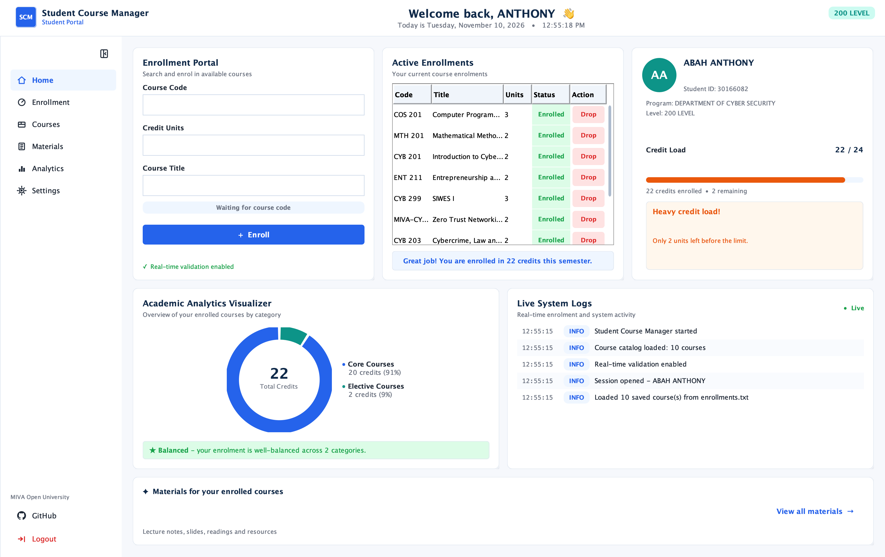
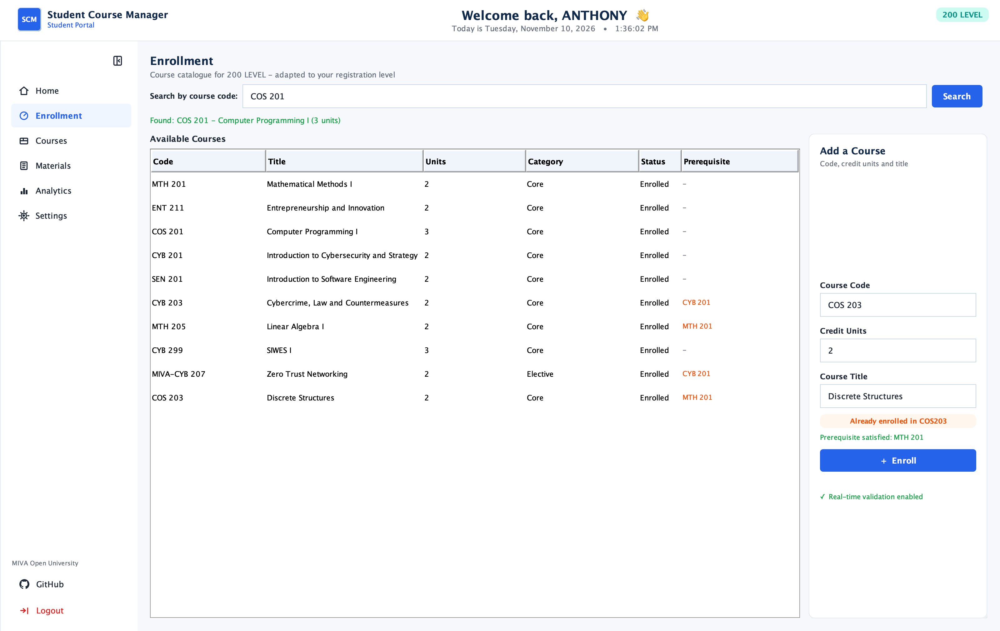
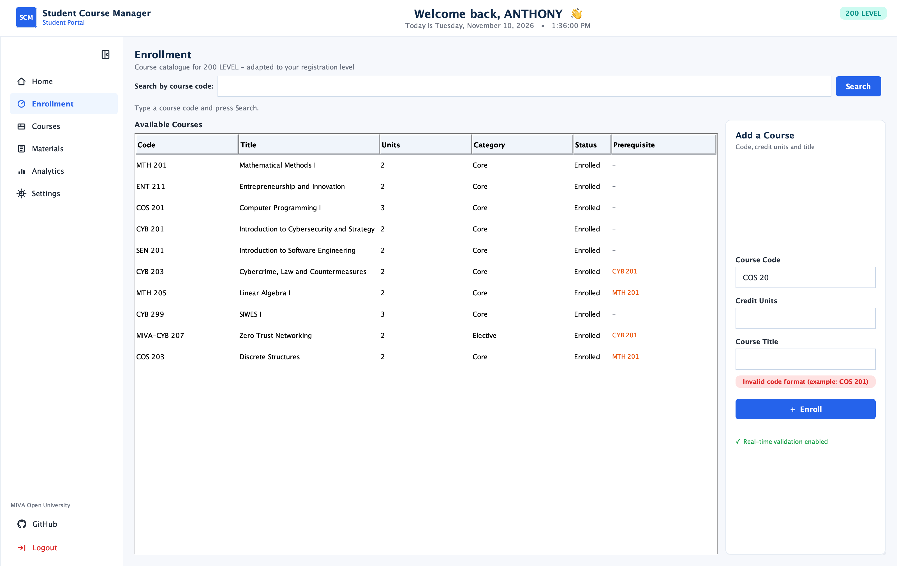

# Student Course Management System

Mid-semester lab assessment project for **COS 201 - Computer Programming I**,
MIVA Open University.

A Java Swing portal where a student signs in, enrols in courses, searches
the catalogue, tracks credit units and saves or loads the course list from
a text file. The seeded 200 Level course list adapts to whichever level a
student registers with (COS 201 becomes COS 301 for a 300 Level student).

## Screenshots



*The dashboard: enrolled courses, the credit load, analytics and the activity log on one screen.*



*Searching the catalogue by course code and getting the result on screen.*



*Real-time validation: an incomplete code is rejected with an inline message before anything is saved.*

<p align="center">
  
</p>

*The sign-in screen.*

## Install (no Java needed)

Download the installer for your computer from the
[Releases](https://github.com/UncleT-cyber/COS201-StudentCourseManagement/releases/latest)
page. The program and its own Java runtime are packed inside the installer,
so nothing else has to be installed.

| Computer | Download | Steps |
|----------|----------|-------|
| Windows | [`StudentCourseManager-1.0-Windows.exe`](https://github.com/UncleT-cyber/COS201-StudentCourseManagement/releases/latest/download/StudentCourseManager-1.0-Windows.exe) | Run the installer, then open **Student Course Manager** from the Start Menu or the Desktop |
| macOS | [`StudentCourseManager-1.0-macOS.dmg`](https://github.com/UncleT-cyber/COS201-StudentCourseManagement/releases/latest/download/StudentCourseManager-1.0-macOS.dmg) | Open the DMG, drag **Student Course Manager** into Applications, then right-click the app and choose **Open** the first time |

Sign in with the seeded student ID **30166082** (no password). The
[`SCM.jar`](https://github.com/UncleT-cyber/COS201-StudentCourseManagement/releases/latest/download/SCM.jar)
on the same page is the plain Java build for anyone with Java 8 or newer.

## Requirements (building from source)

- JDK 8 or newer (tested on JDK 26)
- No external libraries, no Maven, no Gradle

## Compile

Open a terminal in the project folder and run:

```sh
javac -d out $(find src -name "*.java")
```

On Windows (Command Prompt):

```cmd
dir /s /b src\*.java > sources.txt & javac -d out @sources.txt
```

## Run

```sh
java -cp out ui.Main
```

Sign in with the seeded student ID **30166082** (no password), or create an
account from the Register tab.

To open the portal straight away with the seeded account:

```sh
java -cp out ui.Main --demo
```

## Run the self test

Checks the recursive search, the recursive total, the enrolment rules and
the level adaptor. Every line should print `PASS`.

```sh
java -cp out test.ManagerSelfTest
```

## Data files

Run from the project folder, the program keeps its files next to the source.
An installed copy keeps the same files in a folder called
`Student Course Manager` inside your home directory.

| File | Purpose |
|------|---------|
| `courses.txt` | Master course catalogue, shipped with the project |
| `data/enrollments.txt` | Your saved enrolments, written on exit |
| `data/students.txt` | Registered student accounts |

Delete `data/` to start fresh; the program recreates it on the next run.

## Project layout

```
src/
  model/    Course, CourseTemplate, Student, CourseMaterial
  core/     CourseManager, CourseAdaptor, CourseFileIO, SeedData,
            ActivityLog, InvalidCourseException
  ui/       Main, LoginFrame, DashboardFrame and the screen panels
  test/     ManagerSelfTest
docs/       Overview, design, recursion notes, challenges
screenshots/  Screenshots of the running program
```
